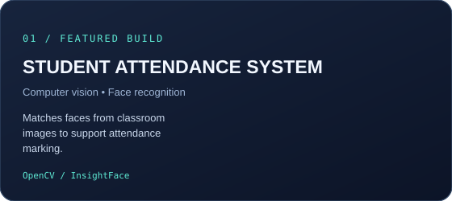
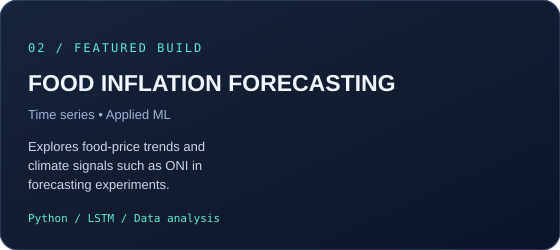
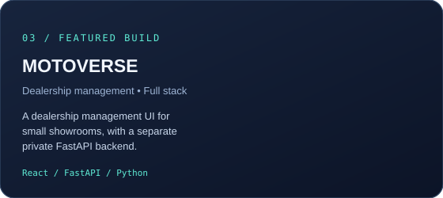
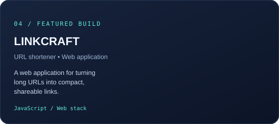
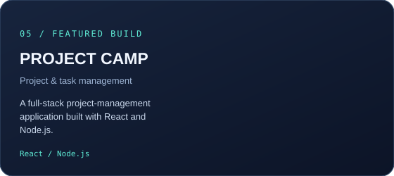
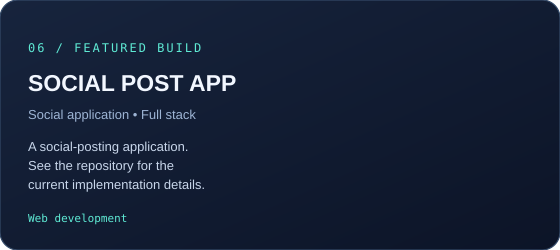
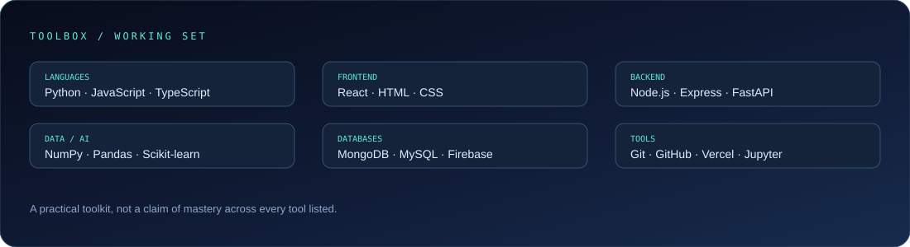

<div align="center">

  

[](https://mudassir-siddiqui.vercel.app)
[](https://www.linkedin.com/in/mudassir-siddiqui-9a3b37256/)
[](mailto:mudassirsid54@gmail.com)
[](https://github.com/MudassirSiddiqui54?tab=repositories)

_I like understanding how systems work, then building useful things with them._

</div>


## A little about how I build

I'm a B.Tech student in **Artificial Intelligence & Data Science** at K. J. Somaiya Institute of Technology, Mumbai.

My work sits at the intersection of **applied AI/ML and full-stack engineering**. I enjoy moving between data, models, APIs, interfaces, and the practical decisions that turn an idea into a working product.

I don't want to use a technology just because it's popular. I want to understand the problem, choose a sensible approach, build it, test its limitations, and improve it.

```text
01  Understand the problem
02  Explore the data and constraints
03  Design the system
04  Build and validate
05  Iterate based on what actually works
```


## Selected builds

These projects represent different parts of my engineering interests: computer vision, applied machine learning, backend systems, and user-facing applications.

<table>
<tr>
<td width="50%" valign="top">
<a href="https://github.com/MudassirSiddiqui54/Student-Attendance-System">

</a>
<p align="center"><a href="https://github.com/MudassirSiddiqui54/Student-Attendance-System">↗ Explore repository</a></p>
</td>
<td width="50%" valign="top">
<a href="https://github.com/MudassirSiddiqui54/PBL-project-Food_Inflation">

</a>
<p align="center"><a href="https://github.com/MudassirSiddiqui54/PBL-project-Food_Inflation">↗ Explore repository</a></p>
</td>
</tr>
<tr>
<td width="50%" valign="top">
<a href="https://github.com/MudassirSiddiqui54/motoverse-frontend">

</a>
<p align="center"><a href="https://github.com/MudassirSiddiqui54/motoverse-frontend">↗ Frontend repository</a></p>
</td>
<td width="50%" valign="top">
<a href="https://github.com/MudassirSiddiqui54/Linkcraft">

</a>
<p align="center"><a href="https://github.com/MudassirSiddiqui54/Linkcraft">↗ Explore repository</a></p>
</td>
</tr>
<tr>
<td width="50%" valign="top">
<a href="https://github.com/MudassirSiddiqui54/Project-camp">

</a>
<p align="center"><a href="https://github.com/MudassirSiddiqui54/Project-camp">↗ Explore repository</a></p>
</td>
<td width="50%" valign="top">
<a href="https://github.com/MudassirSiddiqui54/social-post-app">

</a>
<p align="center"><a href="https://github.com/MudassirSiddiqui54/social-post-app">↗ Explore repository</a></p>
</td>
</tr>
</table>

**Also:** [Portfolio source](https://github.com/MudassirSiddiqui54/Portfolio-new) · [Live portfolio](https://mudassir-siddiqui.vercel.app)

> MotoVerse uses a separate private FastAPI backend; only the frontend repository is linked publicly. The Student Attendance System's frontend is not currently included in its public repository.


## Technical toolkit



My current focus is strengthening the fundamentals behind machine learning and deep learning while continuing to build complete applications.


## What I'm exploring

- **Deep learning:** neural-network fundamentals, training workflows, and model evaluation.
- **Machine learning:** feature engineering, model selection, and honest validation.
- **AI engineering:** connecting model capabilities to useful software systems.
- **Full-stack development:** maintainable APIs, authentication, data flow, and product-quality interfaces.

## GitHub activity

<div align="center">


</div>


<div align="center">

<a href="https://mudassir-siddiqui.vercel.app"></a>

[Portfolio](https://mudassir-siddiqui.vercel.app) · [LinkedIn](https://www.linkedin.com/in/mudassir-siddiqui-9a3b37256/) · [Email](mailto:mudassirsid54@gmail.com) · [GitHub](https://github.com/MudassirSiddiqui54)

<sub>Designed with hand-built SVG assets · Built to render in GitHub Markdown</sub>

</div>
